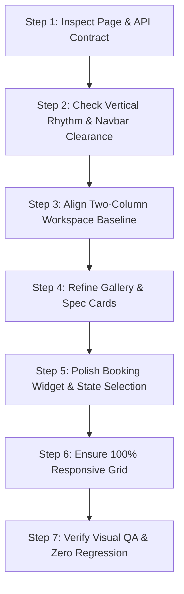

# Prime Rides Page Design System & Implementation Skill

This skill governs visual and structural improvements across Prime Rides public luxury vehicle detail pages. It provides a non-destructive procedure to elevate page aesthetics into a premium luxury automotive standard (matching brands like Rolls-Royce, Bentley, Sixt Luxury, and Turo Black) while strictly safeguarding existing business logic, authentication, pricing calculators, APIs, and adjacent website surfaces.

---

## 1. Core Luxury Design Principles

1. **Restrained Luxury Palette**: Deep Obsidian Midnight (`#090e1a`), Rich Prime Gold (`#c59b27`), Warm Gold accents (`#dfb743`, `#f7d58b`), Soft Canvas (`#f8fafc`), and Pure White (`#ffffff`) card surfaces. No arbitrary bright saturated hues or clashing gradients.
2. **8px Spatial Rhythm**: All padding, margins, gaps, and heights adhere to strict multiples of 8px (8, 16, 24, 32, 40, 48, 64px) with half-step 4px (12px, 20px) reserved for micro-spacing.
3. **Harmonious Two-Column Desktop Architecture**:
   - Left Column (7/12 or 58%): Showcase Gallery + Spec Grid + Vehicle Overview Dossier + Inclusions + Policies.
   - Right Column (5/12 or 42%): Sticky Booking Engine (`CarBookingCard`) anchored at `top-28 sm:top-32` aligned flush with the left column's baseline.
4. **Subtle Elevation & Borders**:
   - Borders: `1px solid rgba(226, 232, 240, 0.85)` (`border-slate-200/90`). Active gold borders: `2px solid #c59b27`.
   - Shadows: Soft diffuse ambient shadows (`shadow-[0_12px_40px_rgba(0,0,0,0.05)]`). Never harsh, murky dropshadows.
5. **Controlled Typography Hierarchy**:
   - H1 Car Title: `text-3xl sm:text-4xl font-extrabold text-[#090e1a] tracking-tight font-heading`.
   - Price Display: `text-3xl font-black text-[#090e1a]` with clean sub-label `/ 300 km Package`.
   - Micro-caps / Badges: `text-[10px] sm:text-[11px] font-bold uppercase tracking-wider`.
6. **Strict Scope Protection**:
   - Only modify target vehicle detail page code (`/cars/[slug]` and its scoped components).
   - Never tamper with booking mutation routes, auth verification, database schemas, or global layouts.

---

## 2. Step-by-Step Procedure

### Step 1: Pre-flight Verification & Navbar Clearance
- Check that the page wrapper has sufficient top padding (`pt-28 sm:pt-32 pb-20`) so the fixed navbar never obscures the breadcrumb or car title.
- Ensure the breadcrumb and location hub pills sit above the main title row.

### Step 2: Harmonize the Two-Column Alignment
- Left column (Gallery) and Right column (Booking Card) must start at the exact same horizontal `y` coordinate.
- Booking card must be set to `sticky top-28 sm:top-32` so it smoothly follows user exploration without overlapping footer elements.

### Step 3: Vehicle Showcase Gallery (`CarGallery`)
- Support multi-angle photography with smooth thumbnail track.
- Include glassmorphic micro-badges (`Prime Certified Clean Handover`, `100% Commercial Insurance`, and photo counter `1 / N`).
- Thumbnail buttons must have smooth hover/selection states (`border-2 border-[#c59b27]` when active).

### Step 4: Specification Matrix & Vehicle Dossier
- 4-column balanced spec grid (Seating, Transmission, Fuel, Engine Power) with equal height cards, gold icon accents, bold dark slate values, and clean sub-labels.
- Overview dossier with clear prose, eliminating brand name stutter (e.g. `Rolls Royce Rolls Royce Cullinan`).
- Inclusions rendered as structured 2-column cards with soft emerald checkmark badges.
- Policies rendered as a clean 3-column matrix for deposit, KM tariff, and fuel rules.

### Step 5: Booking Engine Card (`CarBookingCard`)
- Starting rate clearly announced with `/ package` duration.
- Package selection cards styled with clean hover and gold active states.
- Separation of package title and extra KM tariff badge to prevent label collisions.
- Dark luxury reservation prompt (`#090e1a` + gold sparkle) for visitors.
- Prime gold gradient button (`.modern-card-btn`) with hover elevation.

### Step 6: Multi-Device Responsive Verification
- Verify layout at 1920px (large desktop), 1440px (standard desktop), 1024px (tablet landscape), 768px (tablet portrait), and 390px/375px (mobile).
- Mobile: single column stack, gallery snaps smoothly, booking widget sits naturally below specs.

---

## 3. Related Documentation

- Design System Reference: [references/design-system.md](references/design-system.md)
- Layout Guidelines: [references/layout-guidelines.md](references/layout-guidelines.md)
- Typography Reference: [references/typography.md](references/typography.md)
- Component Guidelines: [references/component-guidelines.md](references/component-guidelines.md)
- Visual QA Checklist: [references/visual-qa-checklist.md](references/visual-qa-checklist.md)

